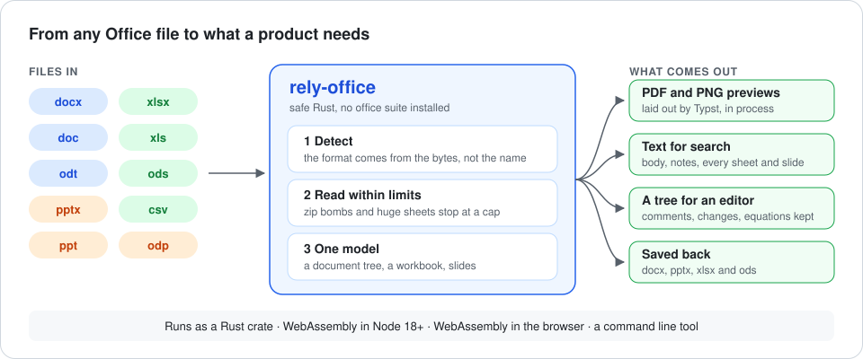
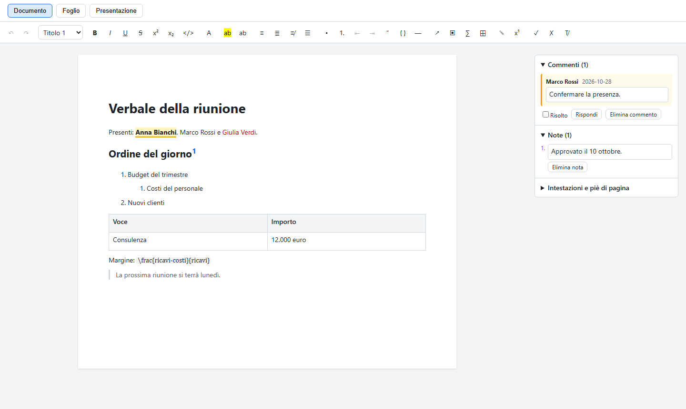
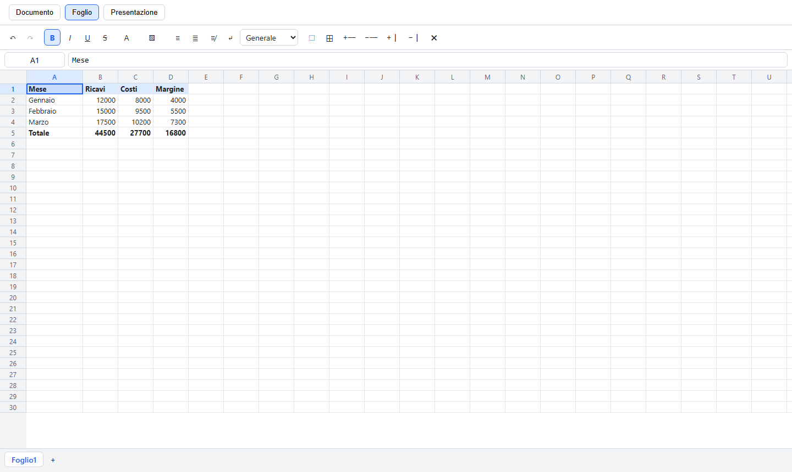
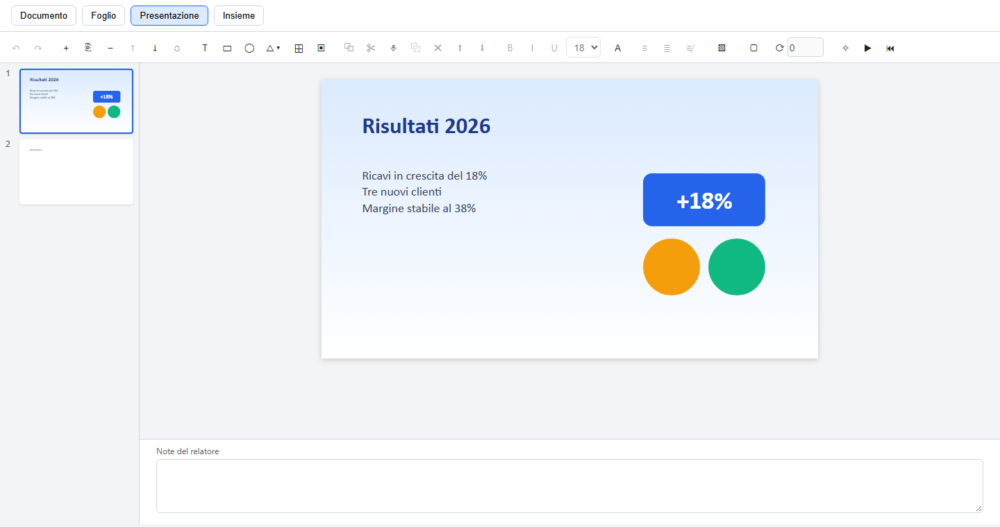
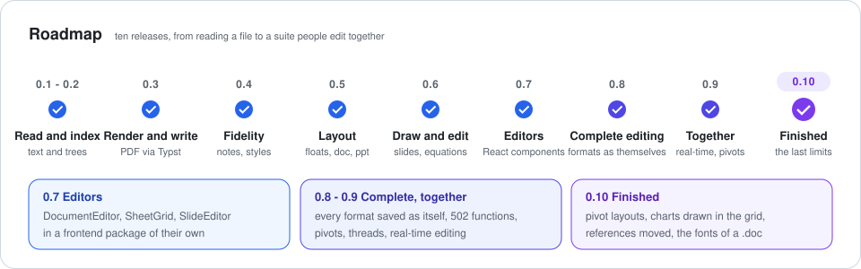

# rely-office

Office documents without an office suite, in safe Rust: format detection, text for search, sheets
as tables, a `.docx`, `.doc`, `.odt`, Markdown or HTML file as a document tree for a rich-text
editor, rendering to PDF and PNG through Typst, writing `.docx`, `.odt`, Markdown or HTML back from
that tree and `.pptx` or `.odp` from slides, so a Word or PowerPoint 97-2003 file converts to a new
format, slides edited as JSON, and an editable spreadsheet with Excel's function library, names,
comments, charts, conditional formats and validation that saves xlsx, ods and csv. It runs natively and, compiled to WebAssembly, in process from Node and in the
browser, where React components edit documents, spreadsheets and slides.

rely-office is built and maintained by [RelyBytes Consulting](https://relybytes.com) for the Drive
of the [Rely Platform](https://relyplatform.app), where it previews, indexes, edits and exports the
files a team stores, and is published under the Mozilla Public License 2.0 so that it stays open.

<p align="center">
  
</p>

## Why it exists

- **No office suite on the server.** Previews, thumbnails and conversions used to mean a
  LibreOffice or Gotenberg container per service. rely-office is a library: one dependency, in
  process, the same build on every platform.
- **Safe on untrusted files.** Safe Rust, a format read from the bytes and every input under a
  [`Limits`](crates/rely-office-core/src/limits.rs) cap, fuzzed with `cargo-fuzz`: a file from a
  stranger cannot exhaust the process that opens it.
- **One model for everything.** A document becomes one tree whatever its format, so a `.doc` from
  1997, an `.odt` and a `.docx` are drawn, indexed, edited and saved by the same code.
- **Checked against the real thing.** Pages are compared with LibreOffice on a corpus of Italian
  documents; [rendering.md](docs/rendering.md) has the method and the figures.

## In production

In the Drive of the Rely Platform, rely-office runs inside the Node service as WebAssembly and:

| Feature | Calls |
| --- | --- |
| Shows Word, Excel, PowerPoint and OpenDocument files as pages, with a thumbnail of the first page | `render` |
| Indexes the text of every Office file for search | `extractText` |
| Opens a `.docx`, `.doc` or `.odt` as an editable document, images included | `readDocumentTree` |
| Downloads an edited document as Word | `writeDocx` |

## What it does

| Format | Detect | Text for search | Sheets as tables | Document tree | Render | Write | Edit |
| --- | --- | --- | --- | --- | --- | --- | --- |
| docx | yes | body, headers, footers, notes | - | yes, with comments, tracked changes, equations, floating images and embedded objects | layout, with sections, headers, footers, notes, floating objects with text around their outline, drawn shapes, metafiles, charts, SmartArt and equations | as docx, odt, Markdown or HTML | through the tree |
| doc (97-2003, Word 6 and 95) | yes | every story | - | yes | layout, as a docx | as docx or odt | through the tree |
| odt | yes | body with headers and footers | - | yes | layout, as a docx | as odt, docx, Markdown or HTML | through the tree |
| md, html | by name or doctype | yes | - | yes | layout, as a docx | as Markdown, HTML, docx or odt | through the tree |
| xlsx, xlsm | yes | every sheet, tab separated | yes, from A1 | - | layout, with its print settings, cell formats, conditional formats, merges, and pictures and charts over their cells | yes | yes, with names, threaded comments, charts and pivot tables made and changed; its styles, merges, rules, pictures and macros kept |
| ods | yes | every sheet | yes | - | layout, as an xlsx | as ods, xlsx or csv | yes, its names, comments, pictures, charts and pivot tables kept |
| xls | yes | every sheet | yes | - | layout | as xlsx | yes |
| csv, tsv | by name, text only | yes | yes, UTF-8 or Windows-1252, `;` or `,` | - | layout | as csv, xlsx or ods | yes |
| pptx, odp | yes | slides and pages with their notes | - | slides | slides, with their masters, shapes, gradient and picture fills, tables, pictures, charts and SmartArt | as pptx or odp | as slides, with notes, transitions and animations |
| ppt (97-2003) | yes | every text atom outside the masters | - | slides | slides, with their masters, shapes, fills, tables and pictures | as pptx or odp | as slides |

The format comes from the bytes, never from the file name alone. Every input is bounded by
[`Limits`](crates/rely-office-core/src/limits.rs): the input size, each decompressed archive
member or stream (the zip bomb defence), the characters of text, the rows and columns of a table,
and the images of a document tree; the spreadsheet model caps sheets and cells, formulas their
length and nesting.

## Use it from Rust

```toml
[dependencies]
rely-office-core = "0.8"    # reading, the document tree, writing docx, odt, Markdown, HTML, pptx and odp
rely-office-render = "0.8"  # PDF and PNG through Typst
rely-office-sheet = "0.8"   # the editable spreadsheet
```

```rust
use rely_office_core::{Limits, extract_text, read_document_tree, write_docx};
use rely_office_render::{RenderRequest, Renderer};
use rely_office_sheet::{CellRef, Locale, Workbook, write_xlsx};

let bytes = std::fs::read("contratto.docx")?;
let extracted = extract_text(&bytes, Some("contratto.docx"), &Limits::default())?;
let tree = read_document_tree(&bytes, &Limits::default())?;
let copy = write_docx(&tree)?;

let renderer = Renderer::new(font_files); // TrueType or OpenType files, read once
let rendered = renderer.render(&bytes, Some("contratto.docx"), &RenderRequest::default())?;

let mut workbook = Workbook::new();
workbook.set_input(0, CellRef::new(0, 0), "=SOMMA(B1:B9)", Locale::Italian)?;
let xlsx = write_xlsx(&workbook)?;
```

## Two npm packages: one for the backend, one for the frontend

| Package | Where | What |
| --- | --- | --- |
| [`@relybytes/rely-office`](packages/rely-office-node) | Node 18 or later | every call below, rendering to PDF and PNG included; synchronous, no native addon |
| [`@relybytes/rely-office-react`](packages/rely-office-react) | the browser | reading and writing documents, presentations and spreadsheets, and the React editors over them |

They declare the same model from one file, so a tree read on the server opens in the editor and a
document saved in the browser is read back by the server. Rendering stays on the backend: the
typesetter is 31 MB of WebAssembly.

### On the backend

```js
const office = require('@relybytes/rely-office');

office.extractText(bytes, 'contratto.docx');            // { format, text, truncated }
office.readDocumentTree(bytes);                         // { blocks, media, report, comments?, objects? }
office.readPresentation(pptx);                          // { slides, media, ... }, back with writePptx
office.render(bytes, 'contratto.docx', { thumbnailWidth: 320 }); // { pdf, thumbnail, ... }
office.writeDocx({ blocks, media });                    // Uint8Array, or writeOdt, writeMarkdown, writeHtml
office.convertToDocx(doc);                              // a Word 97-2003 file as docx
office.convertToPptx(ppt);                              // a PowerPoint 97-2003 file as pptx
const sheet = office.openSheet(xlsx, 'conti.xlsx');     // edit, recalculate, save()
```

The package [README](packages/rely-office-node/README.md) has the whole API.

### In the browser

```tsx
import { DocumentEditor, initDocuments, openDocument } from '@relybytes/rely-office-react';
import '@relybytes/rely-office-react/styles.css';

await initDocuments();
const { document } = openDocument(bytes, { fileName }); // docx, doc, odt, Markdown or HTML
<DocumentEditor ref={editor} document={document} />;    // then editor.current.saveDocx(), or saveDocumentAs
```

`SheetGrid` edits a workbook from `openSheet` and `SlideEditor` a presentation from
`readPresentation` the same way; the package [README](packages/rely-office-react/README.md) has
all three.

| Documents | Spreadsheets | Slides |
| --- | --- | --- |
|  |  |  |

## From a terminal

```sh
cargo run -p rely-office-cli -- text contract.docx
cargo run -p rely-office-cli -- tree contract.docx
cargo run -p rely-office-cli -- pdf contract.docx       # writes contract.docx.pdf
cargo run -p rely-office-cli -- png sales.xlsx          # one PNG per page
cargo run -p rely-office-cli -- svg logo.emf            # an EMF or WMF picture as SVG
cargo run -p rely-office-cli -- rewrite contract.docx   # through the tree and back
cargo run -p rely-office-cli -- rewrite relazione.doc   # a doc converted to docx
cargo run -p rely-office-cli -- rewrite riunione.ppt    # a ppt converted to pptx
cargo run -p rely-office-cli -- rewrite sales.xlsx      # through the editable model and back
cargo run -p rely-office-cli -- ods sales.xlsx          # a spreadsheet saved as ods
```

Renders use the fonts of the folder `RELY_OFFICE_FONTS` names, by default `./fonts`.

## Roadmap

<p align="center">
  
</p>

Six releases took the library from text extraction to drawing and saving every format above; 0.7
added the editor components, React components that edit the document tree, the workbook and the
slides directly. **0.8 makes the editing complete across the formats**: an odt, an odp, Markdown,
HTML and csv are saved as themselves, the spreadsheet has Excel's function library with names,
`LET` and `LAMBDA`, comments and charts made and changed in the grid, and floating images are
edited in the document editor. What comes next is in the [roadmap](docs/roadmap.md).

## Build and test

```sh
cargo test --workspace
rustup target add wasm32-unknown-unknown
cargo install wasm-bindgen-cli --version "$(node scripts/build-npm.mjs --print-bindgen-version)" --locked
node scripts/build-npm.mjs                          # writes both packages to dist/
node packages/rely-office-node/test/smoke.cjs       # every Node export
(cd packages/rely-office-react && npm test)         # the editors over the real WebAssembly
node packages/rely-office-react/test/smoke-dist.mjs # the built browser runtime
SOFFICE=soffice node scripts/corpus.mjs           # pages compared with LibreOffice
```

## Layout

| Path | Purpose |
| --- | --- |
| [`crates/rely-office-core`](crates/rely-office-core) | detection, text, sheet tables, print settings and rules, the document tree and its looks, Markdown and HTML, the slide model, the docx, odt, Markdown, HTML, pptx and odp writers |
| [`crates/rely-office-render`](crates/rely-office-render) | documents to Typst source, typeset to PDF and PNG |
| [`crates/rely-office-sheet`](crates/rely-office-sheet) | the editable spreadsheet: formulas, names, recalculation, edits, comments, charts, conditional formats and validation, xlsx, ods and csv out |
| [`crates/rely-office-cli`](crates/rely-office-cli) | the `rely-office` command |
| [`crates/rely-office-wasm`](crates/rely-office-wasm), [`-render-wasm`](crates/rely-office-render-wasm), [`-sheet-wasm`](crates/rely-office-sheet-wasm) | the WebAssembly fronts |
| [`crates/rely-office-corpus`](crates/rely-office-corpus) | the page comparison with LibreOffice |
| [`packages/rely-office-node`](packages/rely-office-node) | the backend package `@relybytes/rely-office`, and `model.d.ts`, the model both packages declare |
| [`packages/rely-office-react`](packages/rely-office-react) | the frontend package `@relybytes/rely-office-react`: the browser runtime and the editor components |
| [`corpus/`](corpus) and [`scripts/corpus.mjs`](scripts/corpus.mjs) | the Italian documents of the comparison |
| [`fonts/`](fonts) | the fonts the package ships: metric-compatible text faces under the SIL Open Font License 1.1, and DejaVu Math TeX Gyre for equations |
| [`fuzz/`](fuzz) | cargo-fuzz targets |

The design is in [docs/](docs/README.md): [architecture](docs/architecture.md),
[rendering](docs/rendering.md), [editing](docs/editing.md), [the document tree](docs/document-tree.md)
and the [roadmap](docs/roadmap.md); the changes of each release in [CHANGELOG.md](CHANGELOG.md).

## Licence

Mozilla Public License 2.0, see [LICENSE](LICENSE). In short: you may use rely-office in any
software, open or closed; changes to the files of rely-office itself must be published under the
same licence, and the copyright notices of RelyBytes Consulting must be kept. See [NOTICE](NOTICE)
for the attribution and for the licences of the dependencies; the fonts in `fonts/` carry their own
licence texts.

## Contributing

Contributions are welcome under the Developer Certificate of Origin: sign off every commit
(`git commit -s`). There is no contributor licence agreement, so the licence of a contribution is
the licence of the project. See [CONTRIBUTING.md](CONTRIBUTING.md). Security reports go through
the private channel in [SECURITY.md](SECURITY.md), never a public issue.
