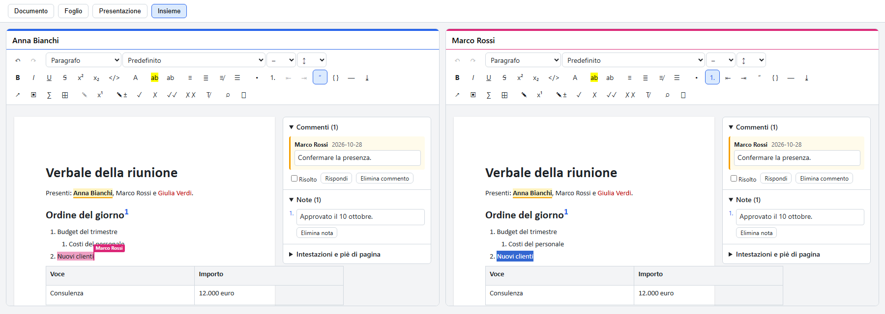
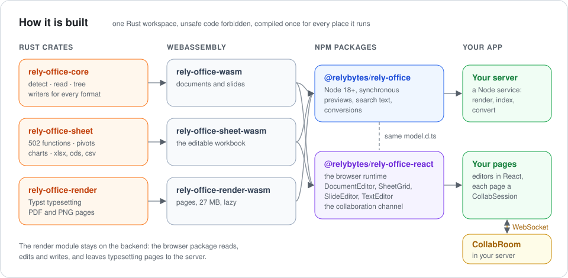
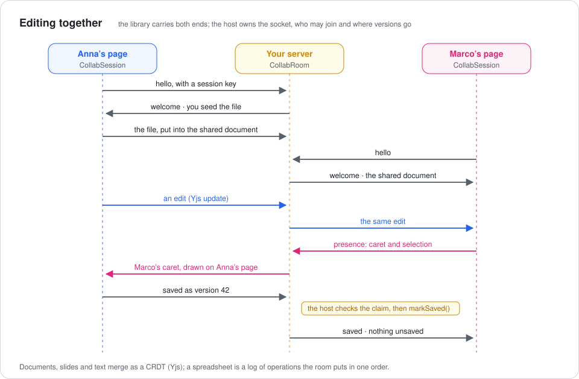
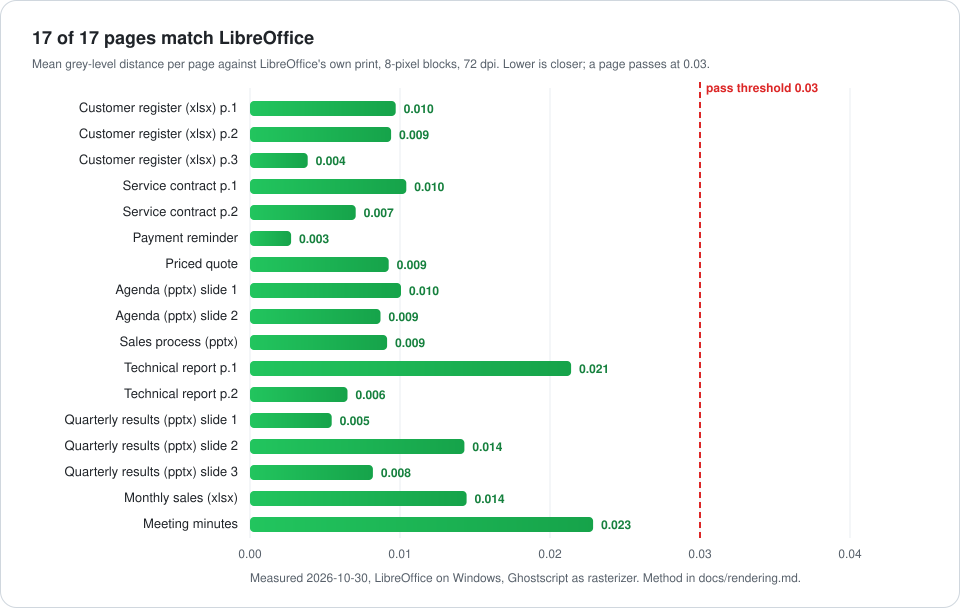
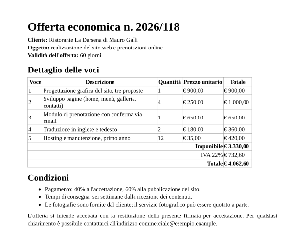
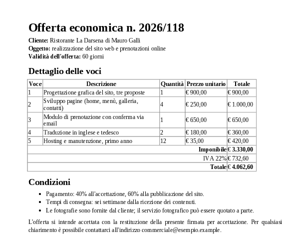

<p align="center">
  
</p>

<p align="center">
  <a href="LICENSE"></a>
  <a href="https://github.com/relybytes/rely-office/actions/workflows/ci.yml"></a>
  <a href="https://github.com/relybytes/rely-office/actions/workflows/fuzz.yml"></a>
  
  
  <a href="https://github.com/relybytes/rely-office/packages"></a>
</p>

<p align="center">
  <a href="#see-it">See it</a> ·
  <a href="#how-it-works">How it works</a> ·
  <a href="#quick-start">Quick start</a> ·
  <a href="#editing-together">Editing together</a> ·
  <a href="#checked-against-libreoffice">Fidelity</a> ·
  <a href="#formats">Formats</a> ·
  <a href="#roadmap">Roadmap</a>
</p>

**rely-office** reads, draws, edits and writes Word, Excel, PowerPoint and OpenDocument files with
no office suite anywhere: one Rust library, compiled to WebAssembly, that runs in process in Node
and in the browser. A server gets previews, thumbnails, search text and conversions from it; a page
gets four React editors, for documents, spreadsheets, slides and plain text, that several people can
use at the same time.

It is built and maintained by [RelyBytes S.r.l.](https://relybytes.com) for the Drive of the
[Rely Platform](https://relyplatform.app), where it previews, indexes, edits and exports every
file a team stores, and it is published under the Mozilla Public License 2.0 so that it stays open.

## See it

| Documents | Spreadsheets |
| --- | --- |
|  |  |
| **Slides** | **Together** |
|  |  |

Every picture is the demo of the frontend package, `npm run demo` in
[`packages/rely-office-react`](packages/rely-office-react): the files it opens are made in the page
itself.

## How it works

<p align="center">
  
</p>

Every format is read into **one model**: a document becomes one tree whatever its format, a
workbook one editable spreadsheet, a presentation one list of slides. So a `.doc` from 1997, an
`.odt` and a `.docx` are drawn, indexed, edited and saved by the same code, and an editor never
knows which format it opened.

<p align="center">
  
</p>

| Layer | What it gives | Where it runs |
| --- | --- | --- |
| `rely-office-core` | format detection from the bytes, text for search, the document tree, the slide model, the docx, odt, Markdown, HTML, pptx and odp writers | Rust, Node, browser |
| `rely-office-sheet` | the editable spreadsheet: 502 functions, names, `LET` and `LAMBDA`, comments and threads, charts, pivot tables, conditional formats, validation; xlsx, ods and csv out | Rust, Node, browser |
| `rely-office-render` | pages typeset through Typst into PDF and PNG | Rust, Node |
| `@relybytes/rely-office` | every call above, synchronous, no native addon | Node 18 or later |
| `@relybytes/rely-office-react` | reading and writing in the browser, `DocumentEditor`, `SheetGrid`, `SlideEditor`, `TextEditor`, and the collaboration channel | the browser, and the room on any JavaScript server |

**Safe on untrusted files.** The format comes from the bytes, never from the name alone; every
input is capped by [`Limits`](crates/rely-office-core/src/limits.rs) (input size, each decompressed
member, text, rows and columns, images), the spreadsheet caps sheets, cells and formula nesting,
`unsafe` is forbidden across the workspace, and six `cargo-fuzz` targets run every week. A file from
a stranger cannot exhaust the process that opens it.

## Quick start

### On the backend

```js
const office = require('@relybytes/rely-office');

office.extractText(bytes, 'contratto.docx');            // { format, text, truncated }
office.render(bytes, 'contratto.docx', { thumbnailWidth: 320 }); // { pdf, thumbnail, pages }
office.readDocumentTree(bytes);                         // the tree an editor opens
office.convertToDocx(doc);                              // a Word 97-2003 file as docx
const sheet = office.openSheet(xlsx, 'conti.xlsx');     // edit, recalculate, save()
```

### In the browser

```tsx
import { DocumentEditor, initDocuments, openDocument } from '@relybytes/rely-office-react';
import '@relybytes/rely-office-react/styles.css';
import '@relybytes/rely-office-react/fonts.css'; // optional: metric-compatible Office fonts

await initDocuments();
const { document } = openDocument(bytes, { fileName }); // docx, doc, odt, Markdown or HTML
<DocumentEditor ref={editor} document={document} />;    // then editor.current.saveDocx()
```

`SheetGrid` edits a workbook from `openSheet`, `SlideEditor` a presentation from
`readPresentation` and `TextEditor` a text file from `openTextFile` the same way. The package
READMEs, [backend](packages/rely-office-node/README.md) and
[frontend](packages/rely-office-react/README.md), have the whole API.

### From Rust

```toml
[dependencies]
rely-office-core = "0.10"    # reading, the document tree, the writers
rely-office-render = "0.10"  # PDF and PNG through Typst
rely-office-sheet = "0.10"   # the editable spreadsheet
```

```rust
use rely_office_core::{Limits, extract_text, read_document_tree, write_docx};
use rely_office_sheet::{CellRef, Locale, Workbook, write_xlsx};

let bytes = std::fs::read("contratto.docx")?;
let text = extract_text(&bytes, Some("contratto.docx"), &Limits::default())?;
let copy = write_docx(&read_document_tree(&bytes, &Limits::default())?)?;

let mut workbook = Workbook::new();
workbook.set_input(0, CellRef::new(0, 0), "=SOMMA(B1:B9)", Locale::Italian)?;
let xlsx = write_xlsx(&workbook)?;
```

### From a terminal

```sh
cargo run -p rely-office-cli -- pdf contract.docx       # writes contract.docx.pdf
cargo run -p rely-office-cli -- png sales.xlsx          # one PNG per page
cargo run -p rely-office-cli -- rewrite relazione.doc   # a doc converted to docx
cargo run -p rely-office-cli -- ods sales.xlsx          # a spreadsheet saved as ods
```

## Editing together

Documents, presentations, spreadsheets and text files can be edited by several people at once,
each seeing the others' carets and selections, each undoing only their own edits. The library
carries both ends of the channel and no transport: the host owns the WebSocket, who may join, and
where the room and the versions are stored.

<p align="center">
  
</p>

| Kind | Shared as | Why |
| --- | --- | --- |
| documents, presentations, text | a Yjs document, merged by its CRDT | text and lists of shapes merge without anyone deciding |
| spreadsheets | operations the room puts in one order | a formula, a sort or a row insert rewrites cells across sheets, so every client's engine applies each edit in the same order; formulas written meanwhile have their references moved |

A server runs a room in a few lines, with no React and no TipTap installed:

```ts
import { CollabRoom } from '@relybytes/rely-office-react/collab';

const room = new CollabRoom(storedState, {
  events: { update: append, operation: append, saveClaim: verifyThenMarkSaved },
});
socket.on('message', (frame) => room.receive(peer.id, new Uint8Array(frame)));
room.join({ id: peer.id, canWrite, send: (frame) => socket.send(frame) });
```

The protocol, the room's state and the save handshake are in
[docs/collaboration.md](docs/collaboration.md).

## Checked against LibreOffice

Pages are typeset by rely-office and compared with the print of LibreOffice on a corpus of
Italian business documents: every page passes.

<p align="center">
  
</p>

| rely-office | LibreOffice |
| --- | --- |
|  |  |

The method, the fonts and the figures are in [docs/rendering.md](docs/rendering.md); CI runs the
comparison on every push.

## Formats

| Format | Detect | Text for search | Render | Open in an editor | Save as |
| --- | --- | --- | --- | --- | --- |
| docx, docm | yes | body, headers, footers, notes | pages with sections, floating objects, shapes, charts, SmartArt and equations | `DocumentEditor`, with comments, tracked changes, equations, images and the document's fonts | itself, odt, Markdown, HTML; the macros of a docm kept, never run |
| doc (97-2003, Word 6 and 95) | yes | every story | pages | `DocumentEditor` | docx or odt |
| odt | yes | body, headers and footers | pages | `DocumentEditor` | itself, docx, Markdown, HTML |
| md, html | by name or doctype | yes | pages | `DocumentEditor` | itself, docx, odt |
| xlsx, xlsm | yes | every sheet | pages with print settings, formats, rules, pictures and charts | `SheetGrid`, with names, threaded comments, charts and pivot tables | itself, ods, csv; macros kept, never run |
| ods | yes | every sheet | pages | `SheetGrid` | itself, xlsx, csv |
| xls | yes | every sheet | pages | `SheetGrid` | xlsx |
| csv, tsv | by name | yes | pages | `SheetGrid` | itself, xlsx, ods |
| pptx, pptm, odp | yes | slides and notes | slides with masters, fills, tables, pictures, charts and SmartArt | `SlideEditor`, with notes, transitions and animations | itself, pptx or odp; macros kept, never run |
| ppt (97-2003) | yes | every text atom | slides | `SlideEditor` | pptx or odp |
| txt | by name | yes | - | `TextEditor`, encoding, byte order mark and line ending kept | itself |

The old binary formats are read, never written: saving one gives its modern twin.

## Roadmap

<p align="center">
  
</p>

Ten releases took the library from text extraction to a suite people edit together. What comes
next is in the [roadmap](docs/roadmap.md), the changes of each release in
[CHANGELOG.md](CHANGELOG.md).

## Build and test

```sh
cargo test --workspace
rustup target add wasm32-unknown-unknown
cargo install wasm-bindgen-cli --version "$(node scripts/build-npm.mjs --print-bindgen-version)" --locked
node scripts/build-npm.mjs                          # writes both packages to dist/
node packages/rely-office-node/test/smoke.cjs       # every Node export
(cd packages/rely-office-react && npm test)         # the editors over the real WebAssembly
(cd packages/rely-office-react && npm run demo)     # the demo of the pictures above
SOFFICE=soffice node scripts/corpus.mjs             # pages compared with LibreOffice
```

## Layout

| Path | Purpose |
| --- | --- |
| [`crates/rely-office-core`](crates/rely-office-core) | detection, text, the document tree and its looks, fonts, Markdown and HTML, the slide model, the writers |
| [`crates/rely-office-render`](crates/rely-office-render) | documents to Typst source, typeset to PDF and PNG |
| [`crates/rely-office-sheet`](crates/rely-office-sheet) | the editable spreadsheet: formulas, names, recalculation, comments, charts, pivot tables, rules; xlsx, ods and csv out |
| [`crates/rely-office-cli`](crates/rely-office-cli) | the `rely-office` command |
| [`crates/rely-office-wasm`](crates/rely-office-wasm), [`-render-wasm`](crates/rely-office-render-wasm), [`-sheet-wasm`](crates/rely-office-sheet-wasm) | the WebAssembly fronts |
| [`crates/rely-office-corpus`](crates/rely-office-corpus) | the page comparison with LibreOffice |
| [`packages/rely-office-node`](packages/rely-office-node) | the backend package, and `model.d.ts`, the model both packages declare |
| [`packages/rely-office-react`](packages/rely-office-react) | the frontend package: the browser runtime, the editors, the collaboration channel and the demo |
| [`corpus/`](corpus) | the Italian documents of the comparison |
| [`fonts/`](fonts) | metric-compatible faces under the SIL Open Font License 1.1, and DejaVu Math TeX Gyre for equations |
| [`fuzz/`](fuzz) | cargo-fuzz targets |

The design is in [docs/](docs/README.md): [architecture](docs/architecture.md),
[rendering](docs/rendering.md), [editing](docs/editing.md),
[collaboration](docs/collaboration.md), [the document tree](docs/document-tree.md) and the
[roadmap](docs/roadmap.md).

## Licence

Mozilla Public License 2.0, see [LICENSE](LICENSE). In short: you may use rely-office in any
software, open or closed; changes to the files of rely-office itself must be published under the
same licence, and the copyright notices of RelyBytes S.r.l. must be kept. See [NOTICE](NOTICE)
for the attribution and for the licences of the dependencies; the fonts in `fonts/` carry their own
licence texts.

## Contributing

Contributions are welcome under the Developer Certificate of Origin: sign off every commit
(`git commit -s`). There is no contributor licence agreement, so the licence of a contribution is
the licence of the project. See [CONTRIBUTING.md](CONTRIBUTING.md). Security reports go through
the private channel in [SECURITY.md](SECURITY.md), never a public issue.
